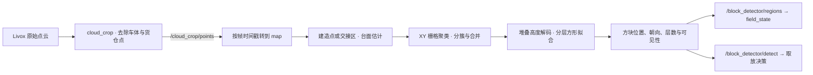

# 雷达方块识别

核对版本 `8046678`。方块检测用的是**基于已知场地与方块尺寸的点云几何算法**。它通过区域裁剪、分层和方形拟合识别地块与天空块。

## 实现逻辑

1. **多帧点云。** 节点订阅裁剪后的 `/cloud_crop/points`，过滤近距离点和无效点，默认取近期 5 你的帧。按各帧时间戳查 TF 后，把可用帧转到 `map`。服务复用缓存，缺失对应 TF 的帧会跳过。该输入保留了方块侧面所需的点云密度。
2. **区域与台面。** 根据场地几何截取指定建造点或交接区。在预期台面高度附近按 1 cm 分箱，取点最多且样本数足够的高度。台面不可见时用规则高度，并在结果中标明。用 5 cm 小格有点的比例估计区域覆盖。
3. **候选堆叠。** 将台面上方点投影到 XY 的 3 cm 栅格，按邻接关系聚类。用高度空档分开悬空物，超大的簇可用 1.5 cm 栅格再分。符合上下层关系的上层簇可并回下方方块堆，避免把较小的天空块当作独立物体。
4. **类型和层数。** 用簇顶部高度与台面之差匹配可能的堆叠组合。地块边长为 0.35 m，天空块边长为 0.20 m，默认高度匹配容差为 0.06 m。每层再截取侧面高度带，避开上下各约 3 cm 的边界。
5. **中心和朝向。** 对候选角度投影侧面点，选投影最集中的方向。先按 1° 粗搜，再按 0.1° 细搜。根据雷达视点从可见面向内推半个已知边长估算中心。边长超限或高度无法匹配时报告 `unknown`，点稀疏时中心可能标为不可靠。
6. **输出。** 建造点摘要采用离区域中心最近的一摞，返回层数、天空块、可见性和可能的顶部截断。检测节点提供区域几何和可见性。天空块的归属与持货记账由 `field_state` 结合动作回报和历史观测维护。

[算法实现](../ros2_ws/src/perception/rc2027_perception/src/block_detector.cpp) · [ROS 节点](../ros2_ws/src/perception/rc2027_perception/src/block_detector_node.cpp) · [参数](../ros2_ws/src/perception/rc2027_perception/config/block_detector.yaml) · [场地几何](rules/field_geometry.yaml)
