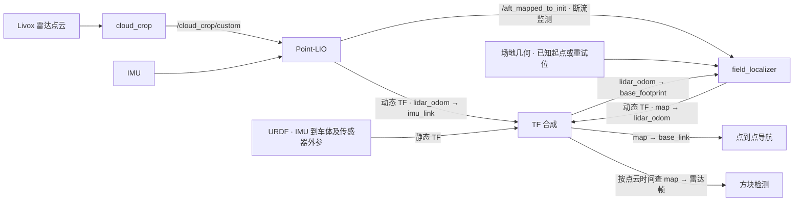
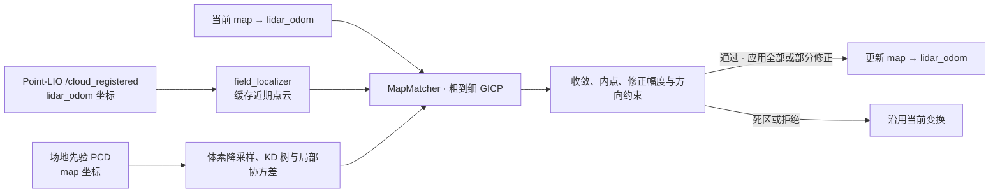

# 定位与点云配准

核对版本 `8046678`，TF 已迁移到 Point-LIO 原生 IMU 发布链路。本文描述仿真定位和配准接口，真机安装外参按实物配置。

## 运行时 TF 树

[仿真 TF 树 PDF](assets/tf-tree-simulation.pdf) 由 ROS 2 `tf2_tools view_frames` 采集实际仿真话题生成。采集时车辆在 L1 起跑位静止，仿真使用独立 ROS 域 83。运行时查到 `map → base_footprint` 平移为 `(-1.800, 2.600, 0.650) m`。图中的发布频率属于当次采样，静态边的速率显示值是 TF 工具的记法。

```text
map
└── lidar_odom        field_localizer 发布
    └── imu_link      Point-LIO 发布所用 IMU 的估计位姿
        └── base_link robot_state_publisher 发布固定安装关系
            ├── base_footprint  车脚及台面高度参考
            ├── lidar_link      实际雷达安装坐标
            │   └── livox_sim   仿真点云消息坐标
            └── 相机、车轮等
```

在容器里加载工作区后，可以在运行时从另一个终端重新抓图。下面的 `2` 对应常规全场仿真，采集时需使用与目标节点相同的 ROS 域。

```bash
source /opt/ros/humble/setup.bash
source /opt/external_ws/install/setup.bash
source /opt/ros2_ws/install/setup.bash
source /workspace/sim_ws/install/setup.bash
export ROS_DOMAIN_ID=2
ros2 run tf2_tools view_frames --ros-args -p use_sim_time:=true
```

## 定位数据流



1. **局部运动估计。** Point-LIO 融合雷达点云与 IMU，维护局部里程计，发出 `lidar_odom → imu_link`、`/aft_mapped_to_init` 和 `/cloud_registered`。当前仿真使用底盘 `/imu/data`，IMU 与 `base_link` 共用参考位姿。真机用内置 IMU 时，静态外参由内置 IMU、雷达和底盘的安装关系合成。
2. **场地初始锁定。** `field_localizer` 从规则几何或重锁请求得到已知的车脚位姿，通过 TF 取得同一车脚在 `lidar_odom` 下的位姿。用已知的 `map → base_footprint` 乘以 `lidar_odom → base_footprint` 的逆，得到 `map → lidar_odom`。仿真 L1 的规则高度是 0.60 m，启动参数另加 0.05 m。
3. **运行维护。** 导航查询 `map → base_link`，场地锁定和高度检查使用 `base_footprint`。定位节点监测里程计断流和高度，仿真换层通过 `floor_change` 与 `relatch` 管理高度约束和重锁。人工 Retry 用已知重试区位姿重锁，会调用 Point-LIO 重置并等新数据。
4. **先验地图精修。** 先验点云存在时，锁定后的自动精修和 `/field_localizer/relocalize` 使用下述配准路径。决策层收到的是校准结果，导航继续使用更新后的 TF。

## 点云配准数据流



1. **准备数据。** `field_localizer` 默认合并近 10 帧在 `lidar_odom` 下的 `/cloud_registered`，以当前场地对齐为初值。匹配器按初值裁掉场外点。源点云和先验地图默认按 0.10 m 体素降采样，并用近邻估计局部协方差。
2. **求解。** `MapMatcher` 调用 `small_gicp`，使用 **广义 ICP（GICP）** 以两级对应点距离求解同一个刚体变换。默认粗配准 1.0 m，细配准 0.3 m。输出候选 `map → lidar_odom`、收敛状态、内点比例、RMSE 和水平约束强弱。
3. **验收和应用。** 定位节点检查点数、收敛、内点比例、车脚处的修正幅度和水平约束。两个水平方向都弱时拒绝。单方向弱时去掉该方向的修正，并继续检查剩余改动。进入死区时沿用现值，高度可独立修正。启用仿真运动预检时，只缓存双向约束充分且无需修正的结果，实际应用变换在停稳后进行。
4. **模块边界。** 配准核心是 `map_matching` CMake 库，由 `field_localizer` 调用。它校准场地对齐。Point-LIO 继续输出局部里程计。

[定位节点](../ros2_ws/src/navigation/rc2027_navigation/localization/src/field_localizer_node.cpp) · [配准核心](../ros2_ws/src/navigation/rc2027_navigation/localization/registration/src/map_matcher.cpp) · [Point-LIO 发布实现](../external_ws/src/point_lio/src/laserMapping.cpp) · [仿真启动配置](../sim_ws/src/rc2027_sim_bridge/launch/sim_mapping.launch.py)
